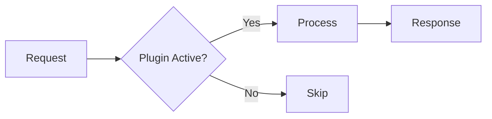

# Gemeinsame Regeln - Wiki.js Dokumentation

Diese Regeln gelten fuer ALLE Projekttypen. Immer zusammen mit dem typ-spezifischen Template laden.

## Bilingual - PFLICHT

Jede Wiki.js-Seite wird in **DE und EN** erstellt/aktualisiert.

- Gleicher Pfad, unterschiedliche Locale (`locale: "de-DE"` / `locale: "en"`). Wiki.js 3 kennt
  `de-DE` und `en`, ein nacktes `"de"` gibt es nicht mehr
- **Kein Sprachlink im Seiteninhalt.** Den Wechsel zwischen DE und EN uebernimmt der globale
  Sprachumschalter des Themes (Link neben "Edit" in der Aktionsleiste). Er baut den Link aus dem
  Pfad, deshalb haben beide Sprachen **denselben Pfad** (Englisch ohne Locale-Praefix, Deutsch unter
  `/de-DE/`). Keine Zeilen wie `[English Version](...)` oder `[Deutsche Version](...)` schreiben
- Code-Beispiele, CLI-Befehle, technische Terme bleiben in beiden Versionen gleich (welche
  Begriffe Lehnwörter bleiben, steht im Glossar von `translation-check`)
- Nur Fliesstext, Ueberschriften, Beschreibungen uebersetzen
- DE- und EN-Seite werden in Wiki.js 3 miteinander **verknuepft** (`localeRelations`), damit der
  Sprachumschalter die jeweils andere Sprache anbietet. Die EN-Seite wird nach der DE-Seite
  angelegt und bekommt `localeRelations: [{locale: "de-DE", path}]` (die Verknuepfung gilt in
  beide Richtungen, die Gegenseite muss schon existieren). Bei einem Update einer unverknuepften
  Bestandsseite per `wikijs_update_page(..., localeRelations: [...])` nachziehen. Der Umschalter im
  Theme braucht die Verknuepfung nicht, sie haelt die beiden Seiten fuer Wiki.js selbst zusammen

## Wiki.js Enhanced Markdown - PFLICHT

Nutze diese Wiki.js-spezifischen Markdown-Features aktiv:

### Callout Boxes (statt normaler Absaetze fuer Warnungen/Tipps)

```markdown
> Wichtiger Sicherheitshinweis: API-Keys niemals im Code speichern.
{.is-warning}

> Tipp: Nutze separate API-Keys fuer verschiedene Integrationen.
{.is-info}

> Fehler: Plugin nicht kompatibel mit osTicket < 1.18
{.is-danger}

> Erfolgreich installiert! Das Plugin ist sofort einsatzbereit.
{.is-success}
```

**KRITISCH - Callout Boxes NIE im Quelltext umbrechen:**

Wiki.js (auch Version 3, an dieser Instanz geprueft) fasst mehrzeilige Bloecke NICHT wie
Standard-CommonMark zu Fliesstext zusammen — jeder einzelne Zeilenumbruch im Quelltext wird als
hartes `<br>` gerendert. Ein Callout muss daher **immer eine einzige, unumbrochene Zeile** sein,
unabhaengig von der Laenge:

```markdown
> Wichtiger Hinweis: Diese lange Warnung wurde bei ca. 90 Zeichen        <-- FALSCH
> umgebrochen, um im Editor besser lesbar zu sein, und rendert in
> Wiki.js mit sichtbaren Zeilenumbruechen mitten im Satz.
{.is-warning}

> Wichtiger Hinweis: Diese lange Warnung steht als eine einzige, unumbrochene Zeile im Quelltext und rendert in Wiki.js als normaler Fliesstext ohne sichtbare Umbrueche.   <-- KORREKT
{.is-warning}
```

Dasselbe gilt fuer Absaetze: nur umbrechen, wo ein Umbruch gewollt ist.

### Badges in einer Zeile

Badges (`[](...)`) stehen in **einer** Zeile, durch Leerzeichen getrennt. Auf mehrere
Quelltext-Zeilen verteilt, wuerde jede Badge wegen des harten `<br>` in einer eigenen Zeile landen:

```markdown
[](https://www.oxid-esales.com) [](https://www.php.net/)
```

### Content Tabs (fuer alternative Wege)

Wiki.js 3 kennt kein `{.tabset}` mehr. Tabs sind ein Block: aeusserer Zaun mit **drei** Doppelpunkten
(`:::block-tabs` ... `:::`), jeder Tab mit **zwei** (`::block-tab{label="..."}` ... `::`). Der aeussere
Zaun hat drei, weil die Tabs darin selbst Bloecke sind. Die Ueberschrift steht davor, nicht im Block.

````markdown
### Installation

:::block-tabs
::block-tab{label="Composer (Empfohlen)"}
```bash
composer require mmd/plugin-name
```
::

::block-tab{label="ZIP Download"}
1. Download von GitHub Releases
2. Entpacken nach /include/plugins/
::

::block-tab{label="Git Clone"}
```bash
git clone https://github.com/markus-michalski/repo-name.git
```
::
:::
````

### Mermaid-Diagramme (Hub und `technical` je mindestens 1)

**Wiki.js 3: Mermaid wird nur innerhalb eines Blocks gezeichnet.** Ein einfacher Code-Zaun mit
`mermaid` erscheint als Code-Block, nicht als Diagramm. Der Block ist `::block-diagram` (zwei
Doppelpunkte, optional mit `caption`), darin der Mermaid-Zaun, am Ende `::`:

`````markdown
::block-diagram{caption="Ablauf einer Anfrage"}

::
`````

Die Mermaid-8.8.2-Einschraenkungen von Wiki.js 2 gelten nicht mehr (`flowchart` ist erlaubt). Labels
mit Sonderzeichen trotzdem in Anfuehrungszeichen setzen (`A["enable()"]`), das haelt die Diagramme
auch in anderen Renderern lesbar.

### Bild-Dimensionen (wenn Bilder vorhanden)

```markdown


```

Ganze Screens (ca. 2400 px breit) ohne Breitenangabe einbinden. Ausschnitte und kleine Dialoge (Zahlart-Block, Hinweisbox, einzelne Formularfelder) mit `=Wx`, W = Pixelbreite / 2. Logos und andere Bilder, die keine Aufnahme sind, mit kleiner Festbreite. Aufnahme-Regeln und Hilfsskript stehen in `SCREENSHOTS.md`.

## Keine Emojis in Ueberschriften

UTF8MB4-Encoding-Problem in osTicket/Wiki.js. Emojis nur im Fliesstext erlaubt.

```markdown
## Systemanforderungen              <-- Korrekt
## 🎯 Systemanforderungen           <-- FALSCH (wird zu ????)
```

Diese Regel gilt auch dann, wenn der User eine Ueberschrift woertlich mit Emoji vorgibt — das
Emoji vor der Uebernahme entfernen, nie unveraendert in die veroeffentlichte Seite durchreichen.

## Keine Versionsnummern im Fliesstext - PFLICHT

Wiki.js-Seiten beschreiben immer nur den **aktuellen Stand** des Plugins/Moduls, keine Versionshistorie.

- KEINE "(ab vX.Y.Z)"-Zusaetze an Ueberschriften oder Feature-Beschreibungen — Versionsnummern
  veralten sofort wieder und muessen bei jedem Release nachgepflegt werden (macht in der Praxis
  niemand)
- Versionsgeschichte gehoert ins CHANGELOG.md des Repos, nicht ins Wiki. Es gibt im Wiki auch
  **keinen Changelog-Abschnitt** und keinen Link darauf (sonst wird er doppelt gepflegt, und bei
  privaten Repos laeuft der Link ins Leere)
- Stattdessen: direkt unter den Badges am Seitenanfang ein Hinweis-Callout, dass
  sich die Doku immer auf die aktuellste Version bezieht
- Diese Regel gilt auch dann, wenn der User selbst eine Versionsnummer nennt und erwartet, dass sie
  dokumentiert wird — die Versionsnummer nicht in Ueberschrift/Fliesstext uebernehmen (das
  Hinweis-Callout deckt das ab)

```markdown
> Diese Dokumentation bezieht sich immer auf die aktuellste veroeffentlichte Version.
{.is-info}
```

EN-Pendant:

```markdown
> This documentation always describes the latest published version.
{.is-info}
```

## Hub + Unterseiten - PFLICHT

Jedes Projekt bekommt **keine** Einzelseite mit allen Inhalten, sondern einen **Hub** mit
Unterseiten. Der Grund: Eine Seite mit Installation, Konfiguration, API, Fehlerbehebung und
Technik ist nicht mehr ueberschaubar. Die Regel gilt fuer alle Projekttypen und auch bei
Update/Qualitaets-Upgrade (siehe "Bestehende Einzelseite umbauen").

### Aufbau

```
{typ}/{projekt}                    Hub: kurze Startseite
{typ}/{projekt}/installation       Unterseite
{typ}/{projekt}/configuration      Unterseite
...
```

- Gleicher Pfad fuer DE und EN (nur `locale` unterscheidet sich), daher **englische Slugs**
- Der Hub ist eine kurze Startseite (ca. eine Bildschirmhoehe plus Tabellen), Detailtexte stehen
  auf den Unterseiten
- Fuer jede Unterseite gilt: nur anlegen, wenn es dazu Inhalt gibt. Leere Seiten oder Seiten mit
  einem Absatz sind falsch, der Inhalt gehoert dann in eine verwandte Seite

### Hub-Inhalt (in dieser Reihenfolge)

1. H1, Badges, "aktuelle Version"-Callout
2. Ueberblick (was, fuer wen, Kern-Vorteil als Callout)
3. Ein Mermaid-Uebersichtsdiagramm
4. **Dokumentation**: Tabelle `Seite | Inhalt` mit Links auf alle Unterseiten (ersetzt das
   frueher manuelle Inhaltsverzeichnis)
5. Features (Tabelle), Anforderungen (Tabelle)
6. Lizenz, Support (kein Changelog-Abschnitt)

Alles andere steht auf Unterseiten.

### Standard-Unterseiten

| Slug | Inhalt | Wann |
|------|--------|------|
| `installation` | Installation (Tabs), Update, Deinstallation, Cronjobs/Scheduled Tasks | immer |
| `configuration` | Einstellungen, Admin-Oberflaeche, Praxis-Beispiele | immer, wenn es etwas zu konfigurieren gibt |
| `troubleshooting` | Fehlerbehebung (Symptoms → Check → Solution), bekannte Einschraenkungen, FAQ | immer |
| `technical` | Architektur-Diagramm, Struktur, Entities/Tabellen, Interna | immer |
| typ-spezifisch | siehe Tabelle "Seite → Sektionen" im jeweiligen Typ-Template (z.B. `shop-api`, `storefront`, `extending`, `tools`, `options`) | bei Inhalt |

Bei Projekten mit sehr vielen gleichartigen Eintraegen (z.B. Skills, Check-Typen) ist eine
Referenzseite oder eine weitere Ebene (`/skills`, `/checks/{name}`) erlaubt. Bestehende
inhaltlich benannte Unterseiten (z.B. `plugins/storyforge/writing-modes`) behalten ihren Slug.

### Konventionen fuer jede Unterseite

- Kopf: direkt die H1, kein Rueck-Link und kein Sprachlink (Brotkrumen und Sprachumschalter des
  Themes uebernehmen das)

  ```markdown
  # {Projekt}: {Thema}
  ```
- Titel: `{Projekt}: {Thema}` (z.B. "ALTCHA: Konfiguration")
- Eigene Description (max 250 Zeichen), die zum Thema der Unterseite passt, nicht die Hub-Description
- Tags wie beim Hub
- Links zwischen Seiten immer als absoluter Wiki-Pfad, Englisch ohne Praefix (`/mcp/...`), Deutsch
  mit `/de-DE/...`, nie als `#anchor` auf eine Seite, die es nicht mehr gibt. Alte `/en/`- und
  `/de/`-URLs funktionieren ueber Weiterleitungen weiter, werden aber nicht mehr neu geschrieben
- Das Mermaid-Pflichtdiagramm liegt auf dem Hub (Uebersicht) und auf `technical` (Detail). Auf den
  uebrigen Unterseiten nur, wenn es den Inhalt klarer macht
- Callouts, Tabs, Troubleshooting-Pattern und alle anderen Regeln dieser Datei gelten
  unveraendert pro Seite

### Navigation nach oben: Brotkrumen - PFLICHT-VORAUSSETZUNG

Den Weg zurueck (Unterseite → Hub → Kategorie → Home) zeigen die **Brotkrumen des Themes**, sie
werden aus dem Seitenpfad gebaut. Deshalb steht **kein manueller Rueck-Link** (`[Back to overview]`,
`[Zurueck zur Uebersicht]`, `[Alle OXID 7 Plugins]`, `[← Zur Hauptuebersicht]`) mehr im
Seiteninhalt. Eine Zeile, die auf eine uebergeordnete Seite zeigt, wird nicht geschrieben.

Damit die Brotkrumen funktionieren, muss die **Pfad-Hierarchie vollstaendig** sein: jede Ebene
eines Pfads existiert als Seite, in beiden Sprachen. Fuer `oxid7/altcha-integration/api` heisst
das, dass `oxid7` (Kategorie-Seite) und `oxid7/altcha-integration` (Hub) vorhanden sind. Beim
Anlegen eines neuen Projekts also pruefen, ob die Kategorie-Seite existiert, und sie sonst
mit anlegen.

- Kategorie-Seiten im HTML-Hero-Layout behalten ihren Link zur Hauptuebersicht im Hero-Bereich
  (helle Linkfarbe wegen dunklem Hintergrund), sie haben keine Brotkrumen-Zeile
- Inhaltliche Links auf andere Seiten (Geschwister, "siehe auch") bleiben erlaubt, nur der
  Link auf eine **uebergeordnete** Seite entfaellt

### Kategorie-Seite (Karten-Uebersicht)

Jede Plattform hat eine Kategorie-Seite (`sylius`, `shopware6`, `oxid7`, `osticket`, `mcp`,
`plugins`, `bash-scripts`) mit einer Karte pro Projekt. Die Karte verlinkt **direkt auf die
Unterseiten**, nicht nur auf den Hub: erster Link der Hub, danach die wichtigsten Unterseiten
(Installation, Konfiguration, Fehlerbehebung, typ-spezifische). Bei neuem Projekt wird die Karte
angelegt, bei Umbau oder neuer Unterseite wird sie nachgezogen. Format der Kategorie-Seite
(HTML-Karten oder Markdown-Tabelle) von der bestehenden Seite uebernehmen, nicht neu erfinden.

**HTML-Bloecke nicht einruecken:** In Wiki.js 3 wird ein eingerueckter HTML-Block nach einer
Leerzeile zum Markdown-Code-Block (4 Leerzeichen = Code). HTML-Karten und Hero-Bereiche beginnen
deshalb in Spalte 0. Nach einer Leerzeile darf keine Zeile des Blocks eingerueckt beginnen.

### Bestehende Einzelseite umbauen (Update und Qualitaets-Upgrade)

Trifft ein Update oder Upgrade auf eine Einzelseite (alles auf einer Seite), wird sie in diesem
Zug zu Hub + Unterseiten umgebaut. Danach nicht zurueck zur Einzelseite.

**Nichts davon wird veroeffentlicht, bevor `/wikijs-plugin:source-check` und
`/wikijs-plugin:translation-check` ueber den fertigen Seiten-Satz gelaufen sind.** Die Schritte 1-2
(laden, Abschnitte zuweisen, Inhalte der neuen Seiten vorbereiten) laufen als Teil der
Content-Erstellung des Rezepts. Die Schritte 3-6 (`wikijs_create_page`, `wikijs_update_page`,
`wikijs_move_page`, Links, Karte) sind Publish-Schritte und kommen erst nach beiden Checks, sonst
steht ein falscher Wert aus der README schon live, bevor der Source-Check ihn sieht.

1. DE und EN laden (`wikijs_get_page`) und die Abschnitte inventarisieren
2. Jedem Abschnitt eine Zielseite zuweisen (Standard-Unterseiten, Tabelle im Typ-Template).
   **Kein Abschnitt darf entfallen.** Vor dem Publish pruefen, dass jeder Abschnitt der alten Seite
   auf genau einer neuen Seite wieder auftaucht
3. Unterseiten zuerst anlegen (`wikijs_create_page`, DE + EN, `isPublished: true` fuer Unterseiten,
   die nur bestehenden Inhalt uebernehmen, `false` nur bei neuem Inhalt, siehe "Draft-first"), danach den Hub per
   `wikijs_update_page` auf die Kurzfassung reduzieren. Der Hub wird dabei weniger als halb so
   lang, also `confirmContentShrink: true` setzen (siehe "content ersetzt die GANZE Seite")
4. Bestehende Unterseiten (z.B. bei StoryForge) auf Standard-Slugs pruefen: Weicht ein Slug nur
   in der Schreibweise von einem Standard-Slug ab, mit `wikijs_move_page` umbenennen, inhaltlich
   benannte Slugs behalten. Den Hub um die Dokumentations-Tabelle ergaenzen
5. Eingehende Links reparieren: `wikijs_search_pages` nach Verweisen auf alte `#anchor` und
   Pfade, in anderen Seiten und in der Kategorie-Seite
6. Kategorie-Karte auf die Unterseiten umstellen
7. Mit `wikijs_get_page` pruefen, dass Hub und alle Unterseiten in beiden Sprachen erreichbar
   sind und alle Links aufloesen

Reihenfolge beim **Neu-Anlegen**: Unterseiten zuerst, Hub zuletzt (damit die Links des Hubs nicht
ins Leere laufen), dann Kategorie-Karte.

## Agent-Orchestrierung

Agents in dieser Reihenfolge einsetzen. Nicht alle sind bei jedem Projekt noetig.

### 1. docs-architect (IMMER)

Codebase analysieren und Hauptdokumentation schreiben.

**Prompt-Hinweise fuer den Agent:**
- README.md, CHANGELOG.md, composer.json/package.json lesen
- Quellcode-Struktur verstehen (src/, tests/, config/)
- Bestehende Doku als Basis nehmen (falls Update/Upgrade)
- Wiki.js Enhanced Markdown verwenden

### 2. mermaid-expert (IMMER)

Mindestens 1 Uebersichtsdiagramm fuer den Hub und 1 Detaildiagramm fuer `technical` erstellen.

**WICHTIG:** Jedes Diagramm steht in einem `::block-diagram`-Block (siehe oben), ein einfacher
`mermaid`-Zaun wird in Wiki.js 3 nicht gezeichnet. Labels mit Sonderzeichen in Quotes.

**Diagramm-Typen nach Bedarf:**
- Flowchart (`graph TD`/`graph LR`): Plugin-Lifecycle, Entscheidungslogik
- Sequence: API Request/Response Flow
- Class: Klassen-Struktur (bei komplexen Plugins)
- ER: Datenbank-Schema (bei DB-Erweiterungen)

### 3. tutorial-engineer (bei Neue Doku / Qualitaets-Upgrade)

Step-by-Step Guides mit Tabs fuer alternative Wege.

**Fokus auf:**
- Installation (verschiedene Methoden als Tabs)
- Haeufigste Use Cases mit konkreten Werten
- Troubleshooting als "Symptoms → Check → Solution" Pattern

### 4. api-documenter (nur bei Projekten mit API)

API-Referenz mit Tabellen.

**Erstelle Tabellen fuer:**
- Endpunkte: Method, Path, Description, Parameters
- Parameter: Name, Type, Required, Default, Description
- Response-Codes: Code, Description, Example

### 5. reference-builder (bei umfangreicher Konfiguration)

Parameter- und Config-Referenz-Tabellen.

**Erstelle Tabellen fuer:**
- Environment Variables
- Plugin-Settings
- CLI-Optionen
- Custom Fields

## Wiki.js MCP-Workflow

### content ersetzt die GANZE Seite — kein Diff/Merge

**KRITISCH:** `wikijs_update_page`s `content`-Parameter, wenn gesetzt, ERSETZT den
kompletten Seiteninhalt. Es gibt kein Patchen oder Anhaengen einzelner Abschnitte.
Vor jedem inhaltlichen Update also IMMER zuerst `wikijs_get_page` aufrufen, den
vollstaendigen Content lokal bearbeiten und den GESAMTEN ueberarbeiteten Text als
`content` zurueckschicken — nie nur den geaenderten Ausschnitt.

Ein Update mit nur der geaenderten Zeile (z.B. ein einzelner korrigierter Link) loescht
den Rest der Seite kommentarlos. Als Sicherheitsnetz lehnt der Server ein Update ab,
wenn der neue Content unter 50% der Laenge des bisherigen Contents liegt (ab ca. 200
Zeichen Bestandslaenge) — der Fehler nennt beide Zeichenzahlen. Ist die Kuerzung
tatsaechlich beabsichtigt, `confirmContentShrink: true` mitgeben:

```
wikijs_update_page(path, locale, content, ..., confirmContentShrink: true, isPublished: true)
```

### isPublished PFLICHT

**KRITISCH:** Bei JEDEM `wikijs_create_page` und `wikijs_update_page` Aufruf
`isPublished` **explizit** setzen, nie dem Default ueberlassen (der Default von
`wikijs_create_page` ist `true`, eine vergessene Angabe veroeffentlicht also).
Welcher Wert gilt, haengt vom Modus ab ("Draft-first" direkt darunter).

```
wikijs_create_page(path, locale, content, ..., isPublished: false)   # Neue Doku
wikijs_update_page(path, locale, content, ..., isPublished: true)    # Update, Upgrade
```

### Draft-first - PFLICHT bei Neue Doku

Neue Seiten werden **immer als Draft** angelegt (`isPublished: false`). Der Grund: Screenshots
(siehe `SCREENSHOTS.md`) liegen beim Anlegen meist noch nicht vor, und eine Seite mit offenen
Platzhaltern darf nicht oeffentlich sein.

- `wikijs_create_page` in Neue Doku: **immer** `isPublished: false`, auch wenn der Skill keine
  Screenshot-Vorschlaege gemacht hat. Ein Draft ist ein Zwischenstand, kein Endzustand
- Veroeffentlicht wird nur ueber das "Freigabe-Gate" weiter unten, nie nebenbei
- Der Draft-Stand durchlaeuft Source-Check und Translation-Check wie jeder andere Stand. Das
  Gate ersetzt sie nicht
- **Update und Qualitaets-Upgrade** bleiben unveraendert: Bestehende, bereits veroeffentlichte
  Seiten bleiben live und werden mit `isPublished: true` aktualisiert. Eine live Seite wird
  nie auf Draft zurueckgesetzt, weil Besucher sonst auf eine fehlende Seite laufen
- Beim Umbau einer Einzelseite zu Hub + Unterseiten (Update, Upgrade) zaehlt der Inhalt: Eine
  Unterseite, die nur **bereits live stehenden Inhalt** uebernimmt, wird mit `isPublished: true`
  angelegt, sonst verschwindet dieser Inhalt oeffentlich, sobald der Hub gekuerzt wird. Nur eine
  Unterseite mit **neuem Inhalt** ist ein Draft. Der live Hub verlinkt sie erst nach deren
  Freigabe (sonst steht ein toter Link auf einer oeffentlichen Seite), und nach der Freigabe
  wird der Hub (Dokumentations-Tabelle) und die Kategorie-Karte um den Link ergaenzt
- Offene Screenshot-Marker gibt es auf live Seiten nicht: Bei Update und Upgrade schlaegt der
  Skill die Screenshots nur vor und fuegt die Bilder erst ein, wenn sie geliefert sind. Bis dahin
  bleibt der bisherige Seitenstand stehen

### Freigabe-Gate - PFLICHT vor dem Veroeffentlichen eines Drafts

Ein Draft wird **nie ohne Freigabe** veroeffentlicht. Eine Freigabe gibt es in genau zwei Faellen:

1. **Screenshots geliefert:** Der User hat die fertigen Bild-URLs geliefert, die Marker sind durch
   Bilder ersetzt, die Pruefung unten ist bestanden
2. **Ausdrueckliche Freigabe:** Der User sagt ausdruecklich, dass die Seiten veroeffentlicht
   werden sollen, auch mit offenen Screenshots (z. B. "veroeffentliche trotzdem", "Seiten
   freigeben")

Nicht als Freigabe zaehlen: Schweigen, bestandene Source- oder Translation-Checks, ein fertiger
Text, "sieht gut aus", die Lieferung nur eines Teils der Screenshots, oder eine Freigabe fuer
andere Seiten oder eine fruehere Sitzung. Im Zweifel nachfragen.

**Pruefung bei Fall 1 (fail-closed):** Vor dem Umschalten auf `isPublished: true` alle Seiten des
Satzes (DE und EN) pruefen:

- Es steht kein Marker `Screenshot folgt [` und kein `Screenshot pending [` mehr im Content
- Jede Bild-URL liefert ein Bild, geprueft mit einem GET statt HEAD (signierte CDNs antworten auf
  HEAD teils mit 403 oder 405): `curl -sL -o /dev/null -r 0-0 -w '%{http_code} %{content_type}'
  --max-time 15 "{url}"`. Bestanden ist nur Status 200 oder 206 **und** ein `Content-Type`, der
  mit `image/` beginnt (eine HTML-Fehlerseite mit Status 200 faellt so durch). Alles andere (403,
  404, Timeout, anderer Typ) blockiert das Veroeffentlichen, der Skill nennt URL und Seite
- Eine Pruefung, die nicht laufen konnte (kein Netz, `curl` fehlt), zaehlt als nicht bestanden,
  nicht als bestanden

**Breitenpruefung (Warnung, blockiert nicht):** Fuer jedes Screenshot-Bild der Seiten die
Pixelbreite lesen und mit der Breitenangabe vergleichen (Regeln in `SCREENSHOTS.md`, Abschnitt
"Aufnahme und Anzeigebreite"). Logos und andere Bilder, die keine Aufnahme sind, werden
uebersprungen. Die ersten Bytes in eine temporaere Datei laden (`curl -sL -r 0-4095 -o "{tmp}"
"{url}"`, `{tmp}` ist ein beliebiger Pfad im Temp-Verzeichnis des Systems) und mit dem Hilfsskript
aus `SCREENSHOTS.md` auswerten (POSIX `${CLAUDE_PLUGIN_ROOT}/bin/run-server`, Windows das
`python.exe` aus dem venv des Plugins, jeweils mit
`${CLAUDE_PLUGIN_ROOT}/servers/wikijs-mcp-server/tools/screenshot_width.py "{tmp}"`). Gemeldet
werden: ein Ausschnitt ohne `=Wx`, ein `=Wx`, das nicht zu Pixelbreite / 2 passt (auch `=Wx` gleich
der Pixelbreite bei Dateien ab 800 px), und Dateien unter 800 px ohne Breitenangabe (vermutlich
nicht mit DPR 2 aufgenommen). Der Skill nennt Seite, Bild und den vorgeschlagenen Wert und fragt,
ob er die Breite setzen soll. Aeltere hochskalierte Bilder duerfen bewusst bei ihrer sichtbaren Breite bleiben.
Konnte die Pruefung nicht laufen, blockiert das die Freigabe nicht, der Skill sagt es nur.

Bei Fall 2 entfaellt die Pruefung. Offene Marker bleiben dann auf der oeffentlichen Seite
stehen, das sagt der Skill dem User vorher in einem Satz und listet die offenen IDs. Spaeter
gelieferte Screenshots werden eingefuegt (Wiedereinstieg im Skill, Schritt 6a): Dort wird nicht nur
nach Drafts gesucht, sondern auch nach live Seiten des Projekts, auf denen noch ein Marker steht.

**Veroeffentlichen:** je Seite `wikijs_update_page(path, locale, isPublished: true, sourceRepo,
sourceRef, summary)` ohne `content` (reines Metadaten-Update). Reihenfolge wie beim Anlegen:
Unterseiten zuerst, Hub zuletzt. Danach `wikijs_mark_verified` je Seite und Sprache, danach die
**Kategorie-Karte** anlegen oder nachziehen. Die Karte verlinkt auf die Unterseiten, deshalb
entsteht sie erst nach der Freigabe, nie vorher.

**Source-Ref bei spaeterer Freigabe (Wiedereinstieg):** `sourceRef` und das Ergebnis des
Source-Checks leben nicht im Draft. Der `sourceRef` kommt aus `wikijs_get_page_history` (Eintrag,
mit dem der Draft angelegt wurde), nicht aus einem neuen `git rev-parse HEAD`. `wikijs_mark_verified`
nur setzen, wenn das PASS (oder das vom User freigegebene WARN) fuer genau diesen Stand in dieser
Sitzung feststeht. Sonst den Source-Check ueber die Seiten neu laufen lassen oder das Markieren
auslassen. Ein Ref, der nie geprueft wurde, darf nie als verifiziert eingetragen werden.

Der Austausch Marker gegen Bild (siehe `SCREENSHOTS.md`) ist ein reiner Bild-Austausch und braucht
keinen erneuten Source-Check oder Translation-Check. Aendert sich dabei auch Text, laufen beide
Checks ueber die geaenderten Seiten.

### Source-Ref-Tracking (wenn verfuegbar)

Bevor Content geschrieben wird: im Zielprojekt-Verzeichnis (dem Repo, das dokumentiert wird)
den aktuellen Git-Stand ermitteln:

```bash
git -C {zielprojekt-pfad} rev-parse HEAD
# oder, falls das Projekt Tags nutzt:
git -C {zielprojekt-pfad} describe --tags --always
```

Ist das Zielprojekt kein Git-Repo (oder der Befehl schlaegt fehl), Source-Ref-Tracking einfach
auslassen — `sourceRepo`/`sourceRef`/`summary` sind optionale Parameter, kein Blocker fuer den
Publish-Schritt.

Ist ein Git-Stand ermittelbar, bei JEDEM `wikijs_create_page`/`wikijs_update_page`-Aufruf
zusaetzlich mitgeben:

```
wikijs_create_page(path, locale, content, ..., isPublished: false,   # Neue Doku: Draft
                    sourceRepo: "{projektname aus Schritt 2}", sourceRef: "{git-hash}",
                    summary: "{ein Satz, was dokumentiert wurde}")
```

`sourceRepo`/`sourceRef`/`summary` landen NUR in einer lokalen Historie
(`wikijs_get_page_history`) — nie im sichtbaren Seiteninhalt oder in der Description. Das erhaelt
die "Keine Versionsnummern im Fliesstext"-Regel oben, macht aber trotzdem nachvollziehbar, auf
welchem Source-Stand eine Seite zuletzt aktualisiert wurde — nuetzlich bei Projekten mit sehr
haeufigen Aenderungen (z.B. taeglich mehrere Doku-Updates).

Der `sourceRef` eines Publish bedeutet nur "geschrieben bei". Als Basis fuer ein Diff-Update
(nur Aenderungen seit dem letzten Stand lesen) gilt erst der **Verified Ref**: Er wird mit
`wikijs_mark_verified` gesetzt, nachdem `/wikijs-plugin:source-check` fuer diese Seite und diesen
Ref bestanden war, und ist mit `wikijs_get_verified_refs` abrufbar. Ohne Verified Ref prueft
`source-check` die ganze Seite gegen den Code. Der Stand liegt in der lokalen DB und gilt pro Rechner.

### Neue Doku erstellen

Immer als Hub + Unterseiten (siehe "Hub + Unterseiten - PFLICHT") und immer als Draft (siehe
"Draft-first - PFLICHT"). `path` und `locale` gelten fuer jede einzelne Seite.
Die Schritte 7-8 und 10-12 laufen je Seite (zuerst alle DE-Seiten, dann alle EN-Seiten, danach das
Markieren je Seite und Sprache). Screenshot-Vorschlaege (Schritt 4), Source-Check (Schritt 5) und
Translation-Check (Schritt 6) laufen dagegen einmal ueber den gesamten Seiten-Satz. Die Schritte
9-14 beginnen erst mit der Freigabe.

```
1. wikijs_search_pages(query: "projektname")                        → Pruefen ob Seite existiert
2. git rev-parse HEAD im Zielprojekt (falls Git-Repo)                → sourceRef ermitteln
3. Inventar aus dem Code bauen (Explore, source-check 1a), dann Seiten-Plan erstellen und Content mit Agents generieren → Hub + Unterseiten, Enhanced Markdown
4. Screenshot-Vorschlaege (SCREENSHOTS.md): Marker in den Content setzen, Vorschlagsliste dem User zeigen → DE und EN mit identischen IDs
5. /wikijs-plugin:source-check über alle DE- und EN-Seiten           → FAIL: mit Codewerten korrigieren, erneut prüfen; WARN: User fragen
6. /wikijs-plugin:translation-check über alle DE- und EN-Seiten      → FAIL: überarbeiten, erneut prüfen; WARN: User fragen
7. wikijs_create_page(path, locale: "de-DE", isPublished: false,
                       sourceRepo, sourceRef, summary, ...)          → je Unterseite DE, dann Hub DE (Draft)
8. wikijs_create_page(path, locale: "en", isPublished: false,
                       localeRelations: [{locale: "de-DE", path}],
                       sourceRepo, sourceRef, summary, ...)          → je Unterseite EN, dann Hub EN (Draft), mit der DE-Seite verknuepft
   Ende des Laufs ohne Freigabe: Draft-Pfade und offene Marker-IDs nennen, dann stoppen
9. Freigabe-Gate: Screenshot-URLs vom User → Marker ersetzen          → wikijs_get_page + wikijs_update_page(..., isPublished: false), Pruefung laut Gate
   ODER ausdrueckliche Freigabe des Users                             → ohne Pruefung, offene IDs vorher nennen
10. wikijs_update_page(path, locale: "de-DE", isPublished: true,
                        sourceRepo, sourceRef, summary)              → ohne content, je Unterseite DE, dann Hub DE
11. wikijs_update_page(path, locale: "en", isPublished: true,
                        sourceRepo, sourceRef, summary)              → ohne content, je Unterseite EN, dann Hub EN
12. wikijs_get_page(path, locale) → updatedAt;
    wikijs_mark_verified(path, locale, sourceRepo, sourceRef,
                          pageUpdatedAt)                             → je Seite und Sprache, nur nach PASS oder vom User freigegebenem WARN
13. Kategorie-Seite: Karte mit Links auf die Unterseiten anlegen      → wikijs_get_page + wikijs_update_page, erst nach der Freigabe
14. wikijs_get_page(path, locale: "de-DE")                              → Hub und Unterseiten verifizieren
```

Unterseiten zuerst, Hub zuletzt, damit die Links des Hubs nicht ins Leere laufen.

### Bestehende Doku updaten

Ist die Doku bereits Hub + Unterseiten, wird nur die betroffene Seite pro Sprache aktualisiert
(und der Hub, falls sich Features/Anforderungen/Dokumentations-Tabelle aendern). Ist sie noch
eine Einzelseite, zuerst "Bestehende Einzelseite umbauen" ausfuehren.

```
1. wikijs_get_page(path, locale: "de-DE")                               → Aktuelle Version laden
2. wikijs_get_page(path, locale: "en")                               → EN-Version laden
3. Einzelseite? → zu Hub + Unterseiten umbauen (siehe oben)          → Umbau vor inhaltlichen Aenderungen
4. git rev-parse HEAD im Zielprojekt (falls Git-Repo)                → sourceRef ermitteln
5. Content mit Agents ueberarbeiten                                  → Aenderungen einarbeiten
6. /wikijs-plugin:source-check über alle geänderten Seiten plus Seiten, auf denen entfernte Inventarpunkte stehen → Gültiger Verified Ref: Code-Diff plus jeden geänderten Abschnitt prüfen; sonst Claim-Check und Inventar-Check (1a) über den ganzen Seiten-Satz (wird Baseline). FAIL: mit Codewerten korrigieren
7. /wikijs-plugin:translation-check über alle geänderten Seiten      → FAIL: überarbeiten, erneut prüfen; WARN: User fragen
8. wikijs_update_page(path, locale: "de-DE", isPublished: true,
                       sourceRepo, sourceRef, summary, ...)          → DE-Version updaten
9. wikijs_update_page(path, locale: "en", isPublished: true,
                       sourceRepo, sourceRef, summary, ...)          → EN-Version updaten
10. wikijs_get_page(path, locale) → updatedAt;
    wikijs_mark_verified(path, locale, sourceRepo, sourceRef,
                          pageUpdatedAt)                             → je Seite und Sprache, nur nach PASS oder vom User freigegebenem WARN
```

### Qualitaets-Upgrade

```
1. wikijs_get_page(path, locale: "de-DE")                               → Aktuelle Version laden
2. Luecken identifizieren:
   - Einzelseite statt Hub + Unterseiten? → zuerst umbauen (siehe oben)
   - Fehlende Mermaid-Diagramme?
   - Keine Callout Boxes?
   - Flache Troubleshooting-Sektion?
   - Fehlende Tabs fuer alternative Wege?
   - Keine Praxisbeispiele?
3. Agents gezielt einsetzen fuer Luecken
4. git rev-parse HEAD im Zielprojekt (falls Git-Repo)                → sourceRef ermitteln
5. /wikijs-plugin:source-check über alle geänderten Seiten plus Seiten, auf denen entfernte Inventarpunkte stehen → Gültiger Verified Ref: Code-Diff plus jeden geänderten Abschnitt prüfen; sonst Claim-Check und Inventar-Check (1a) über den ganzen Seiten-Satz (wird Baseline). FAIL: mit Codewerten korrigieren
6. /wikijs-plugin:translation-check über alle geänderten Seiten      → FAIL: überarbeiten, erneut prüfen; WARN: User fragen
7. wikijs_update_page(path, locale: "de-DE", isPublished: true,
                       sourceRepo, sourceRef, summary, ...)          → DE-Version updaten
8. wikijs_update_page(path, locale: "en", isPublished: true,
                       sourceRepo, sourceRef, summary, ...)          → EN-Version updaten
9. wikijs_get_page(path, locale) → updatedAt;
   wikijs_mark_verified(path, locale, sourceRepo, sourceRef,
                         pageUpdatedAt)                              → je Seite und Sprache, nur nach PASS oder vom User freigegebenem WARN
```

## Qualitaets-Checkliste (vor Publish)

Vor dem Erstellen/Updaten ALLE Punkte pruefen:

- [ ] `/wikijs-plugin:source-check` über DE- und EN-Content durchgelaufen, vor dem Translation-Check (Pfade, Klassen, Config-Keys, Befehle gegen den Code, nicht gegen die README)
- [ ] Source-Check: PASS oder vom User freigegebenes WARN — bei FAIL nicht publizieren; danach `wikijs_mark_verified` mit `pageUpdatedAt` (nicht bei uncommittetem Projekt-Checkout)
- [ ] `/wikijs-plugin:translation-check` über DE- und EN-Content durchgelaufen (DE ist hartes Gate, EN höchstens WARN)
- [ ] Translation-Check: PASS, oder WARN mit User-Entscheidung — bei FAIL nicht publizieren
- [ ] Hub + Unterseiten statt Einzelseite; Hub ist eine kurze Startseite mit Dokumentations-Tabelle
- [ ] Jede Unterseite hat eigene Description und `{Projekt}: {Thema}`-Titel
- [ ] Beim Umbau: jeder Abschnitt der alten Seite steht auf genau einer neuen Seite (nichts verloren)
- [ ] Kategorie-Karte verlinkt auf die Unterseiten
- [ ] Kein manueller Rueck-Link auf eine uebergeordnete Seite, die Pfad-Hierarchie ist vollstaendig (Kategorie-Seite und Hub existieren)
- [ ] Hub und `technical` haben je mindestens 1 Mermaid-Diagramm
- [ ] Callout Boxes fuer Warnungen/Tipps (`.is-warning`, `.is-info`, `.is-danger`, `.is-success`)
- [ ] Keine "(ab vX.Y.Z)"-Versionszusaetze im Fliesstext — stattdessen "aktuelle Version"-Hinweis am Seitenanfang
- [ ] Tabs fuer alternative Installationswege / Konfigurationsmethoden
- [ ] Praxisbeispiele mit konkreten Werten (nicht nur Platzhalter)
- [ ] Troubleshooting mit Symptoms → Check → Solution Pattern
- [ ] Requirements als Tabelle formatiert
- [ ] Keine Emojis in Ueberschriften
- [ ] Tags gesetzt (Projekttyp + Projektname + Themen-Tags)
- [ ] Description ausgefuellt (max 250 Zeichen, beschreibend — siehe Sicherheitsmarge unten)
- [ ] DE + EN Version vorhanden
- [ ] Kein Sprachlink im Seiteninhalt, DE und EN haben denselben Pfad (Voraussetzung fuer den Theme-Umschalter)
- [ ] Callout Boxes (`> ...`) stehen als eine einzige unumbrochene Zeile im Quelltext, nie manuell umgebrochen
- [ ] Badges stehen in einer Zeile, durch Leerzeichen getrennt
- [ ] Badges aktuell (Version, CI-Status, Lizenz)
- [ ] `isPublished` bei jedem MCP-Aufruf explizit gesetzt: Neue Doku `false` (Draft), Update/Upgrade und Freigabe `true`
- [ ] Neue Doku: Screenshot-Vorschlaege gemacht (Marker mit identischen IDs in DE und EN, ausser bei sprachabhaengigen Motiven mit `_de`/`_en`-Suffix, Vorschlagsliste gezeigt) oder bewusst keine, weil das Projekt keine sinnvollen Motive hat
- [ ] Neue Doku: nichts veroeffentlicht ohne Freigabe-Gate (Screenshots geliefert und geprueft, oder ausdrueckliche Freigabe des Users)
- [ ] Kategorie-Karte erst nach der Freigabe angelegt, nicht auf Draft-Seiten verlinkt
- [ ] Mermaid steht in `::block-diagram` (nicht als einfacher Code-Zaun), Labels mit Sonderzeichen in Quotes
- [ ] Tabs als `:::block-tabs` / `::block-tab{label="..."}`, kein `{.tabset}`
- [ ] HTML-Bloecke (Karten, Hero) beginnen in Spalte 0, nicht eingerueckt
- [ ] Links: Englisch ohne Locale-Praefix, Deutsch als `/de-DE/...`

## Wiki.js Seiten-Metadaten

### Tags-Konvention

Vorhandene Tags vor dem Vergeben mit `wikijs_list_tags` pruefen und wiederverwenden (gleiche Schreibweise), statt Varianten wie `Sylius` neben `sylius` anzulegen.

| Projekttyp | Pflicht-Tags | Zusatz-Tags (themenabhaengig) |
|------------|-------------|-------------------------------|
| osTicket | `osticket`, `plugin` | `api`, `markdown`, `subticket`, etc. |
| Shopware6 | `shopware6`, `plugin` | `consent`, `tracking`, `payment`, etc. |
| OXID | `oxid`, `oxid7`, `modul` | `sitemap`, `analytics`, `consent`, etc. |
| Sylius | `sylius`, `plugin` | `spam-protection`, `shop-api`, `checkout`, etc. |
| MCP | `mcp`, `claude-code` | `osticket`, `wikijs`, `api`, etc. |
| Bash | `bash`, `script` | `automation`, `deployment`, etc. |
| Agent | `claude`, `agent` | `skill`, `workflow`, etc. |

### Description-Pattern

```
DE: "[Kurzbeschreibung] fuer [Plattform] - [Hauptfeatures kommasepariert]"
EN: "[Short description] for [Platform] - [Main features comma-separated]"
```

**Max 250 Zeichen** (Sicherheitsmarge). Keine Emojis.

Die Wiki.js-`description`-Spalte ist in der Produktion ein MySQL `VARCHAR(255)` — laengere
Beschreibungen scheitern beim Publish mit `Data too long for column 'description'`. Das
`wikijs_create_page`/`wikijs_update_page`-MCP-Tool nennt in seiner eigenen Docstring faelschlich
"max 500 Zeichen"; massgeblich ist die reale DB-Spalte, nicht die Docstring-Angabe. Vor jedem
Create/Update die Zeichenzahl pruefen und bei > 250 aggressiv kuerzen (Aufzaehlungen/Klammerlisten
zuerst streichen), statt sich auf die 500er-Angabe zu verlassen.
